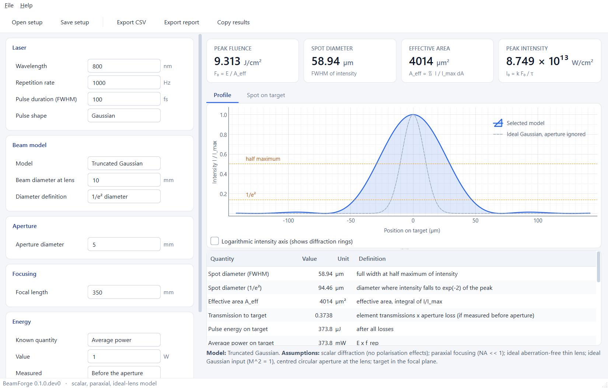

# BeamForge

Computes laser parameters on target (spot size, pulse energy, average power,
fluence, intensity) from a user-defined optical setup. The fluence is computed
from the actual focal profile of the chosen beam model, not from an assumed
flat-top or ideal Gaussian spot. Requirements are in [SPEC.md](SPEC.md).

Status: early development. BeamForge is a working name. Licence: MIT, see
[LICENSE](LICENSE).

## Install

```bash
pip install -e ".[dev]"
```

## Worked example

[examples/reference_setup.toml](examples/reference_setup.toml) describes an
800 nm beam of 10 mm 1/e² diameter, clipped by a 5 mm aperture and focused by a
350 mm lens.

```bash
beamforge examples/reference_setup.toml --csv results.csv
```

The report lists the inputs, the beam model, its assumptions, any warnings, and
every result with its definition. For this setup the spot FWHM is 58.94 µm and
A_eff is 4014 µm², compared with 20.99 µm and 499 µm² if the aperture were
ignored and an ideal Gaussian assumed.

The same from Python, in SI units:

```python
from beamforge import Setup, calculate

result = calculate(
    Setup(
        model="truncated_gaussian",
        wavelength=800e-9,
        focal_length=0.35,
        beam_radius=5e-3,  # 1/e² intensity radius before the lens
        aperture_radius=2.5e-3,
        rep_rate=1e3,
        average_power=1.0,
        measured="before_aperture",
    )
)
print(result["fluence_peak"].value)  # J/m²
```

To go from a wanted fluence to the required energy and power, give
`target_peak_fluence` (`target_peak_fluence_j_cm2` in the file) instead of a
power.

## Desktop application



The desktop application shows the inputs, the focal profile (linear or
logarithmic, and as a 2-D spot), the headline numbers and the full results table
with definitions, assumptions and warnings. Results update as you type. Setups
can be opened and saved as the same TOML files the command line uses, and
results exported as CSV or as a text report. A short start-up screen is shown
first; `--no-splash` skips it.

Run it from source:

```bash
pip install -e ".[gui]"
```

```bash
beamforge-gui examples/reference_setup.toml
```

Build a standalone `dist\BeamForge.exe` for Windows (no Python needed to run it):

```bash
pip install -e ".[gui,build]"
```

```bash
powershell -ExecutionPolicy Bypass -File packaging\build_exe.ps1
```

The interface contains no physics. It builds the same input structure as a setup
file and calls the library, so the GUI, the command line and Python give
identical numbers. It uses PySide6 (Qt) and pyqtgraph, which are optional
dependencies; the library itself needs only numpy and scipy.

## Beam models

| `model` | Class | Needs |
|---|---|---|
| `gaussian` | `GaussianSpot` | beam diameter, focal length; optional M², defocus |
| `truncated_gaussian` | `TruncatedGaussianSpot` | beam diameter, aperture, focal length |
| `airy` | `AirySpot` | aperture, focal length |
| `flat_top` | `FlatTopSpot` | spot diameter on target |

A measured camera image is handled by `beamforge.measured`
(`effective_area_from_image`, `fwhm_from_image`); it is not yet wired into the
setup file.

## Fluence definitions

"Fluence" is never reported without its definition:

- `fluence_peak`: F₀ = E / A_eff, with A_eff = ∬ I/I_max dA. The central value.
- `fluence_average_fwhm_disc`: energy inside the FWHM-diameter disc / disc area.
- `fluence_average_1e2_disc`: energy inside the 1/e²-diameter disc / disc area.
- `fluence_gaussian_equivalent`: 2E / (π w²) with w the 1/e² radius of the
  actual profile.

## Assumptions

Scalar field, paraxial focusing, ideal thin lens. The diffraction models
(`truncated_gaussian`, `airy`) are valid in the focal plane only. Each model
lists its own assumptions in the output.

## Uncertainties

`beamforge.uncertainty` propagates standard uncertainties through any function
of named inputs, first-order (`propagate_first_order`) or by Monte Carlo
(`propagate_monte_carlo`). It is not yet wired into the setup file.


## Tests

```bash
pytest
```

The tests cover the SPEC.md section 5 validation table, the T → 0 and T → ∞
limits of the truncated Gaussian, and analytic values for every other model.

## Use of AI

Parts of this code, its tests and its documentation were generated with an AI
coding tool and reviewed by the author, who is responsible for the content.
[AI_USAGE.md](AI_USAGE.md) logs what was generated and with which tool.
